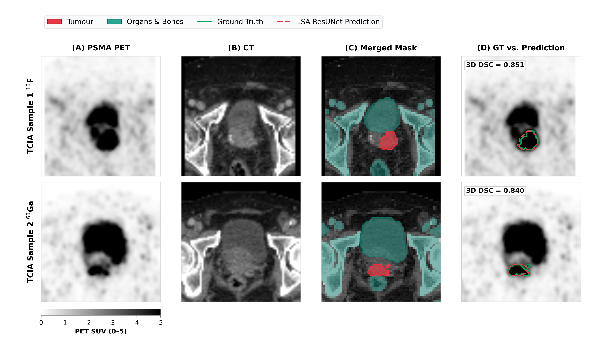

# LSA-ResUNet

Source code for **"LSA-ResUNet: Lightweight Spatial Attention Residual UNet with Transfer Learning for Multicenter PSMA PET/CT Prostate Tumor Segmentation"**, implemented with PyTorch and MONAI.

---

## 1. Repository Structure

```text
LSA-ResUNet/
├── LSA.py                    # 3D LSA-ResUNet architecture (LSAResUNet, DRU, LSA module)
├── pretrain.py               # Supervised 3D pretraining
├── finetune.py               # Fine-tuning with PET Organ CutMix
├── inference.py              # Sliding-window inference (single or multi-fold checkpoints)
├── evaluation.py             # Voxel-level, lesion-level, and PET quantitative evaluation
├── preprocessing/
│   ├── 1_resample_and_clip_ct.py      # Downsample CT/masks to native PET resolution & clip CT [-1000, 1000] HU
│   ├── 2_crop_vesicoprostatic_roi.py  # Crop to target region using bladder/prostate masks
│   └── 3_merge_organ_tumor_mask.py    # Exclude prostate, merge tumour mask, save as <case_id>_*.nii.gz
├── requirements.txt          # Tested Python package dependencies
├── LICENSE                   # Apache-2.0 License
├── assets/
│   └── data_mask_overview.png    # Visual overview of sample PET/CT, MERGED_MASK, and predictions
├── weights/
│   └── best_metric_model_segmentation3d_dict.pth  # Fine-tuned LSA-ResUNet checkpoint
└── demo_data/
    └── TCIA_sample/              # 2 public sample cases from TCIA PSMA-PET-CT-Lesions
```

---

## 2. Environment Setup

Tested with Python 3.10 and CUDA-enabled PyTorch; please install a CUDA-compatible `torch` matching your GPU driver first if on Windows:

```bash
pip install -r requirements.txt
```

---

## 3. Quick-Start Demo

Two public test cases, `sample1` with <sup>18</sup>F-PSMA and `sample2` with <sup>68</sup>Ga-PSMA, from the **TCIA PSMA-PET-CT-Lesions** collection are included in `./demo_data/TCIA_sample/` for immediate verification of inference and quantitative evaluation:

```bash
# 1. Run sliding-window inference with the released checkpoint
python inference.py --data_dir ./demo_data/TCIA_sample --weights ./weights/best_metric_model_segmentation3d_dict.pth --output_dir ./outputs/demo_preds

# 2. Compute voxel-level, lesion-level, and PET quantitative biomarkers
python evaluation.py --pred_dir ./outputs/demo_preds --gt_dir ./demo_data/TCIA_sample --output_csv ./outputs/demo_metrics.csv
```

**Output Locations & Files**:

After running the first inference command, the output directory `./outputs/demo_preds/` is created automatically and stores two predicted binary 3D NIfTI segmentation masks, `sample1_PET_seg.nii.gz` and `sample2_PET_seg.nii.gz`, preserving the spatial affine and header of the input PET images.

After running the second evaluation command, per-case and cohort summary metrics are printed directly to the terminal, and the complete 21-column evaluation table is saved to `./outputs/demo_metrics.csv`.

**Example Console Output**:

```text
Scan_ID | Pred# | GT# | L-TP | L-FP | L-FN | DSC    | V-PPV  | V-Sens | L-PPV  | L-Sens
sample1 | 3     | 1   | 1    | 2    | 0    | 0.8511 | 0.7672 | 0.9555 | 0.3333 | 1.0000
sample2 | 1     | 1   | 1    | 0    | 0    | 0.8395 | 0.8019 | 0.8808 | 1.0000 | 1.0000

Total Evaluated: 2 cases | Mean DSC = 0.8453 ± 0.0058
[CSV Saved] ./outputs/demo_metrics.csv
```

---

## 4. Data Preparation & Preprocessing

### Raw Input Format

Before running preprocessing, prepare each scan in `.nii.gz` format under `<raw_dir>/<case_id>/` with `PET.nii.gz` converted to SUVbw, `CT.nii.gz` in Hounsfield Units, and `ORGAN_MASK.nii.gz` generated from CT using [TotalSegmentator](https://github.com/wasserth/TotalSegmentator) with `--ml`:

```text
raw_data/
└── <case_id>/
    ├── PET.nii.gz          # SUVbw PET image (defines native reference resolution)
    ├── CT.nii.gz           # Raw CT volume in HU
    ├── ORGAN_MASK.nii.gz   # TotalSegmentator multi-label organ mask
    └── TTB.nii.gz          # Tumour ground-truth mask, required for training/evaluation only
```

### Preprocessing Pipeline

Run the three scripts in `preprocessing/` strictly in order **1 → 2 → 3**:

```bash
# Step 1: Downsample CT (linear) and masks (nearest-neighbour) to native PET resolution, clip CT to [-1000, 1000] HU
python preprocessing/1_resample_and_clip_ct.py --input_dir ./raw_data --output_dir ./step1_downsampled

# Step 2: Crop to target region based on bladder and prostate masks (labels 21, 22)
python preprocessing/2_crop_vesicoprostatic_roi.py --input_dir ./step1_downsampled --output_dir ./step2_cropped

# Step 3: Exclude prostate mask (label 22), merge tumour mask, and save as <case_id>_*.nii.gz
python preprocessing/3_merge_organ_tumor_mask.py --input_dir ./step2_cropped --output_dir ./data/dataset/train
```

**Preprocessing Outputs** saved in `--output_dir`, e.g., `./data/dataset/train/`:

```text
data/dataset/train/
├── <case_id>_PET.nii.gz          # Cropped SUVbw PET at native resolution
├── <case_id>_CT.nii.gz           # Downsampled, [-1000, 1000] HU clipped, and cropped CT
└── <case_id>_MERGED_MASK.nii.gz  # Merged mask (present when TTB.nii.gz is provided)
```

Example console output after running Step 3:

```text
[OK] sample1: exported PET, CT, and MERGED_MASK (prostate=22 excluded)
Step 3 complete: 1/1 case(s) exported to ./data/dataset/train
```

**Mask & Split Conventions**:

In `MERGED_MASK`, `label == 0` denotes background and the excluded prostate region, `label == 1` denotes the ground-truth tumour overwriting overlapping organs directly voxel-by-voxel without morphological dilation, and `label > 1` retains the remaining pelvic organs and bones.

Datasets must be **pre-split into `train/`, `val/`, and `test/` subdirectories in advance**, as the training scripts read these folders directly without internal splitting:

```text
data/
├── pretrain_data/
│   ├── train/  (<case_id>_PET.nii.gz, <case_id>_CT.nii.gz, <case_id>_TTB.nii.gz)
│   └── val/
└── finetune_data/
    ├── train/  (<case_id>_PET.nii.gz, <case_id>_CT.nii.gz, <case_id>_MERGED_MASK.nii.gz)
    ├── val/
    └── test/
```

### Sample Data & Mask Overview



*Representative axial slices from the two TCIA demo cases, `sample1` with <sup>18</sup>F-PSMA and `sample2` with <sup>68</sup>Ga-PSMA. **(A)** PSMA PET; **(B)** Registered CT; **(C)** Merged organ and tumour mask; **(D)** Ground-truth vs. single-model `best_metric_model_segmentation3d_dict.pth` prediction, with `3D DSC` computed over the full volume.*

---

## 5. Training, Inference & Evaluation

### Pretraining

```bash
python pretrain.py --data_dir ./data/pretrain_data --output_dir ./outputs/pretrain
```

Optional flags: `--aug_mode random` or `--aug_mode fixed --seed <N>` for random or fixed seed mode, `--epochs 400`, `--batch_size 2`, `--num_samples 128`, `--lr 1e-3`, `--gpu 0`.

**Outputs** saved in `./outputs/pretrain/`:

`best_model_segmentation3d.pth`: best validation DSC checkpoint.

`train_log_<timestamp>.txt`: epoch loss and validation DSC every 2 epochs.

`run_info_<timestamp>.txt`: random seed, `aug_mode`, hyperparameters, and run summary.

### Fine-tuning

```bash
python finetune.py --data_dir ./data/finetune_data --pretrained_path ./outputs/pretrain/best_model_segmentation3d.pth --output_dir ./outputs/finetune
```

Optional flags: `--aug_mode fixed --seed <N>` or `--aug_mode random` for fixed or random seed mode, `--epochs 400`, `--batch_size 2`, `--num_samples 32`, `--lr 1e-3`, `--gpu 0`.

**Outputs** saved in `./outputs/finetune/`:

`best_metric_model_segmentation3d_dict.pth`: best validation DSC checkpoint.

`train_log.txt`: step/epoch training loss and validation DSC every 2 epochs.

`run_info.txt`: random seed, `aug_mode`, pretrained checkpoint path, and dataset counts.

### Inference

```bash
# Single checkpoint inference
python inference.py --data_dir ./data/finetune_data/test --weights ./weights/best_metric_model_segmentation3d_dict.pth --output_dir ./outputs/preds

# Multi-fold ensemble inference (averages sigmoid probabilities across checkpoints)
python inference.py --data_dir ./data/finetune_data/test --weights ./outputs/fold0.pth ./outputs/fold1.pth ./outputs/fold2.pth ./outputs/fold3.pth ./outputs/fold4.pth --output_dir ./outputs/preds_ensemble
```

**Outputs** saved in `--output_dir`, e.g., `./outputs/preds/`: `<case_id>_PET_seg.nii.gz` binary segmentation masks matching the input PET geometry.

### Evaluation

```bash
# When *_PET.nii.gz and *_MERGED_MASK.nii.gz are in the same test directory:
python evaluation.py --pred_dir ./outputs/preds --gt_dir ./data/finetune_data/test --output_csv ./outputs/evaluation_metrics.csv

# Or with separate --gt_dir and --pet_dir:
python evaluation.py --pred_dir ./outputs/preds --gt_dir ./data/ground_truth --pet_dir ./data/pet_images --output_csv ./outputs/evaluation_metrics.csv
```

**Outputs**: Prints per-case and cohort summary statistics — Mean ± SD, Range, Median and IQR — to the terminal and saves the 21-column CSV table to `--output_csv`, e.g., `./outputs/evaluation_metrics.csv`.

**Evaluation Criteria & Exported CSV — 21 Columns**:

**Lesion Counts & Matrix**: `Scan_ID`, `Pred_Lesions`, `GT_Lesions`, `Lesion_TP`, `Lesion_FP`, `Lesion_FN` — 3D 6-connected components; a lesion is a true positive if overlap ≥ 10% of the GT lesion volume **and** the predicted lesion covers the GT lesion's SUV<sub>max</sub> peak voxel.

**Voxel-Level Metrics**: `DSC`, `Voxel_PPV`, `Voxel_Sensitivity`.

**Lesion-Level Metrics**: `Lesion_PPV`, `Lesion_Sensitivity`.

**PET Quantitative Biomarkers & Errors**: `Pred_SUVmean`, `GT_SUVmean`, `Pred_SUVmax`, `GT_SUVmax`, `Pred_PSMA_TV_ml`, `GT_PSMA_TV_ml`, `Pred_TL_PSMA`, `GT_TL_PSMA`, `ARVM_Absolute_Relative_Volume_Metric`, `SUVmean_Signed_Relative_Error`.

---

## 6. Released Checkpoint & Data Availability

**Released Checkpoint**: `./weights/best_metric_model_segmentation3d_dict.pth` was obtained by supervised pretraining of `LSAResUNet` on DEEP-PSMA, followed by fine-tuning on FAHSU-PSMA using PET Organ CutMix and `DiceFocalLoss`, retaining the checkpoint with the highest validation DSC.

**Code License**: Released under the [Apache-2.0 License](./LICENSE).

**TCIA PSMA-PET-CT-Lesions**, including the 2 sample cases in `./demo_data/TCIA_sample/`: Publicly available on The Cancer Imaging Archive at [https://www.cancerimagingarchive.net/collection/psma-pet-ct-lesions/](https://www.cancerimagingarchive.net/collection/psma-pet-ct-lesions/) under CC BY 4.0.

**DEEP-PSMA**: Challenge dataset at [https://deep-psma.grand-challenge.org/](https://deep-psma.grand-challenge.org/).

**FAHSU-PSMA**: Institutional clinical cohort; available from the corresponding author upon reasonable request.
